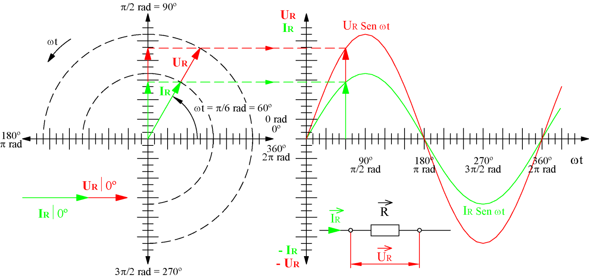
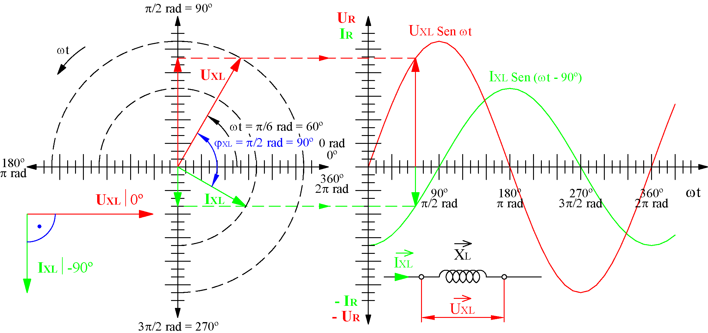
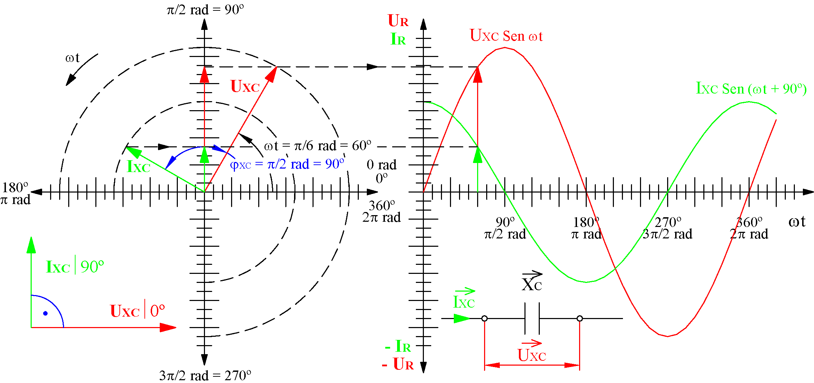
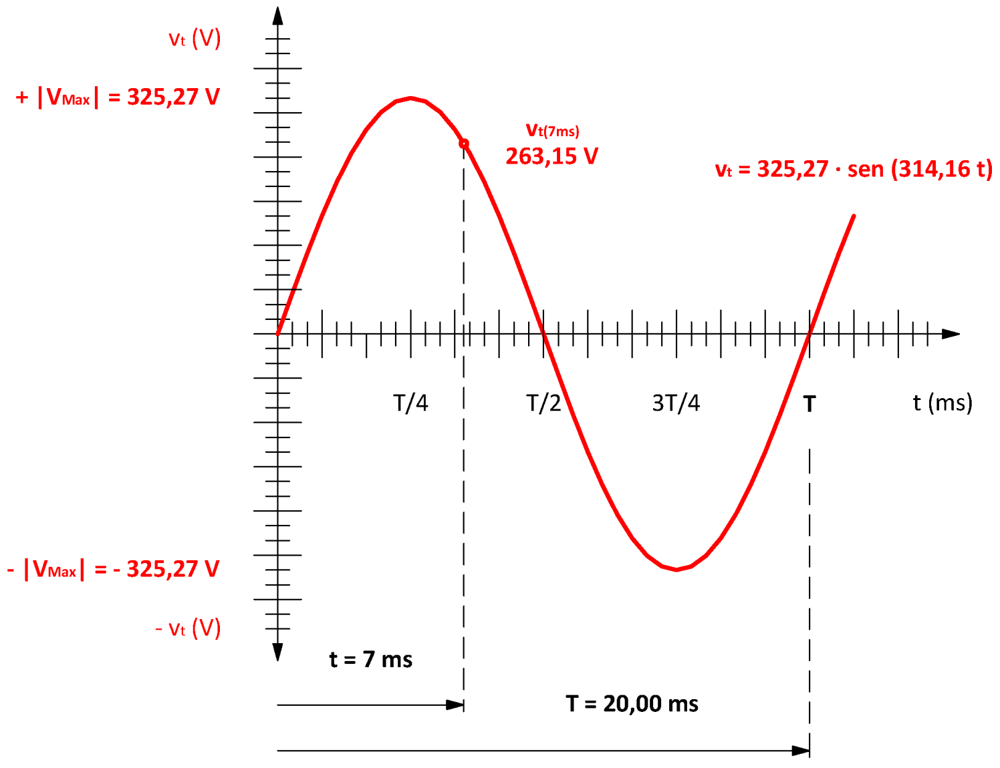
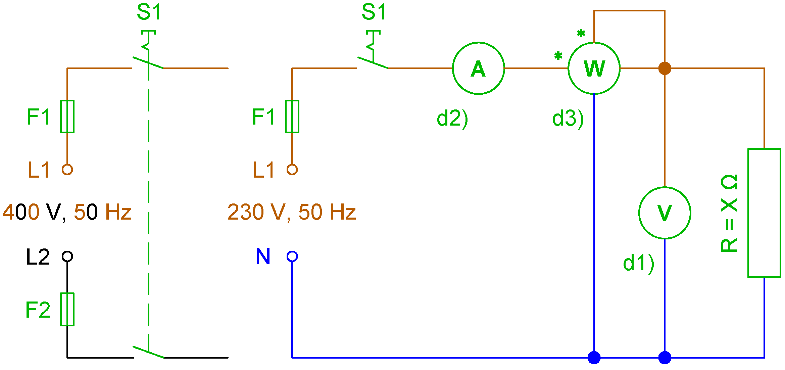
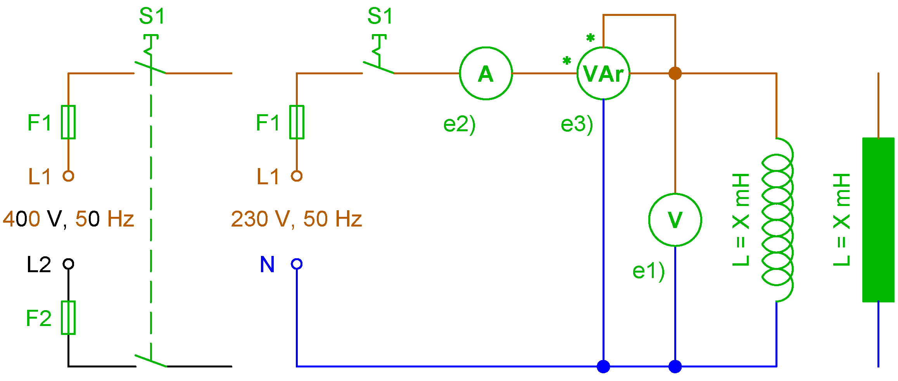
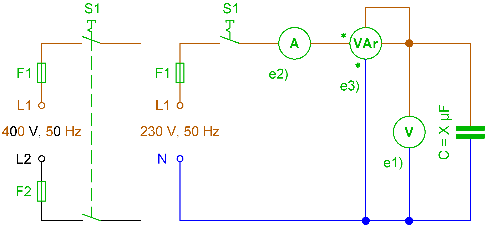

# A2 — Paràmetres característics d'una tensió alterna sinusoïdal

CFPS EEA0 Sistemes Electrotècnics i Automatitzats. MP0520 Sistemes i circuits elèctrics. RA1: determina els paràmetres de sistemes elèctrics, realitzant càlculs o mesures en circuits de corrent altern (c.a.).

A2: paràmetres característics d'una tensió alterna sinusoïdal. Anàlisi funcional de resistències, inductàncies o capacitàncies de corrent altern sinusoïdal.

Edició 2026-2027: 01/10/2026.

## A. Paràmetres característics d'una tensió alterna sinusoïdal

### Exercici proposat A.01

Donada una tensió alterna sinusoïdal monofàsica de 230 V i 50 Hz, determina:

a) Període.
b) Valor màxim, absolut.
c) Pulsació.
d) Valor a l'instant 7 ms.
e) Representació gràfica amb els valors calculats.

### Exercici proposat A.02

Donada una tensió alterna sinusoïdal bifàsica de 320 V i 40 Hz, determina:

a) Període.
b) Valor màxim, absolut.
c) Pulsació.
d) Valor a l'instant 8 ms.
e) Representació gràfica amb els valors calculats.

### Exercici proposat A.03

Donada una tensió alterna sinusoïdal bifàsica de 200 V i 25 Hz, determina:

a) Període.
b) Valor màxim, absolut.
c) Pulsació.
d) Valor a l'instant 34 ms.
e) Representació gràfica amb els valors calculats.

## B. Anàlisi funcional d'una resistència en corrent altern sinusoïdal

### Exercici proposat B.01

Un circuit format per una resistència R = 20 Ω s'alimenta amb una tensió alterna sinusoïdal monofàsica de 230 V i 50 Hz. Determina:

a) Intensitat de corrent de la resistència.
b) Diagrama vectorial V_R – I_R.
c) Potència activa de la resistència.
d) Esquema elèctric del circuit amb la connexió dels instruments necessaris per mesurar a la resistència: d1) tensió; d2) intensitat de corrent; d3) potència activa.

### Exercici proposat B.02

Un circuit format per una resistència R = 100 Ω s'alimenta amb una tensió alterna sinusoïdal monofàsica de 230 V i 50 Hz. Determina els mateixos apartats que a B.01.

### Exercici proposat B.03

Un circuit format per una resistència R = 200 Ω s'alimenta amb una tensió alterna sinusoïdal bifàsica de 400 V i 50 Hz. Determina els mateixos apartats que a B.01.

## C. Anàlisi funcional d'una inductància en corrent altern sinusoïdal

### Exercici proposat C.01

Un circuit format per una bobina d'inductància L = 100 mH s'alimenta amb una tensió alterna sinusoïdal monofàsica de 230 V i 50 Hz. Determina:

a) Reactància inductiva de la bobina.
b) Intensitat de corrent de la bobina.
c) Diagrama vectorial V_XL – I_XL.
d) Potència reactiva de la bobina.
e) Esquema elèctric del circuit amb la connexió dels instruments necessaris per mesurar a la bobina: e1) tensió; e2) intensitat de corrent; e3) potència reactiva.

### Exercici proposat C.02

Un circuit format per una bobina d'inductància L = 200 mH s'alimenta amb una tensió alterna sinusoïdal monofàsica de 230 V i 50 Hz. Determina els mateixos apartats que a C.01.

### Exercici proposat C.03

Un circuit format per una bobina d'inductància L = 400 mH s'alimenta amb una tensió alterna sinusoïdal bifàsica de 400 V i 50 Hz. Determina els mateixos apartats que a C.01.

## D. Anàlisi funcional d'una capacitància en corrent altern sinusoïdal

### Exercici proposat D.01

Un circuit format per un condensador de capacitat C = 100 µF s'alimenta amb una tensió alterna sinusoïdal monofàsica de 230 V i 50 Hz. Determina:

a) Reactància capacitiva del condensador.
b) Intensitat de corrent del condensador.
c) Diagrama vectorial V_XC – I_XC.
d) Potència reactiva del condensador.
e) Esquema elèctric del circuit amb la connexió dels instruments necessaris per mesurar al condensador: e1) tensió; e2) intensitat de corrent; e3) potència reactiva.

### Exercici proposat D.02

Un circuit format per un condensador de capacitat C = 200 µF s'alimenta amb una tensió alterna sinusoïdal monofàsica de 230 V i 50 Hz. Determina els mateixos apartats que a D.01.

### Exercici proposat D.03

Un circuit format per un condensador de capacitat C = 300 µF s'alimenta amb una tensió alterna sinusoïdal bifàsica de 400 V i 50 Hz. Determina els mateixos apartats que a D.01.

## Annex 01. Funcionament de càrregues passives en corrent altern sinusoïdal

### Funcionament d'una resistència en corrent altern sinusoïdal

### Funcionament d'una inductància en corrent altern sinusoïdal

### Funcionament d'una capacitància en corrent altern sinusoïdal

## Annex 02. Solució e) de l'exercici proposat A.01

## Annex 03. Solucions d) i e) dels exercicis proposats B.0x, C.0x i D.0x

