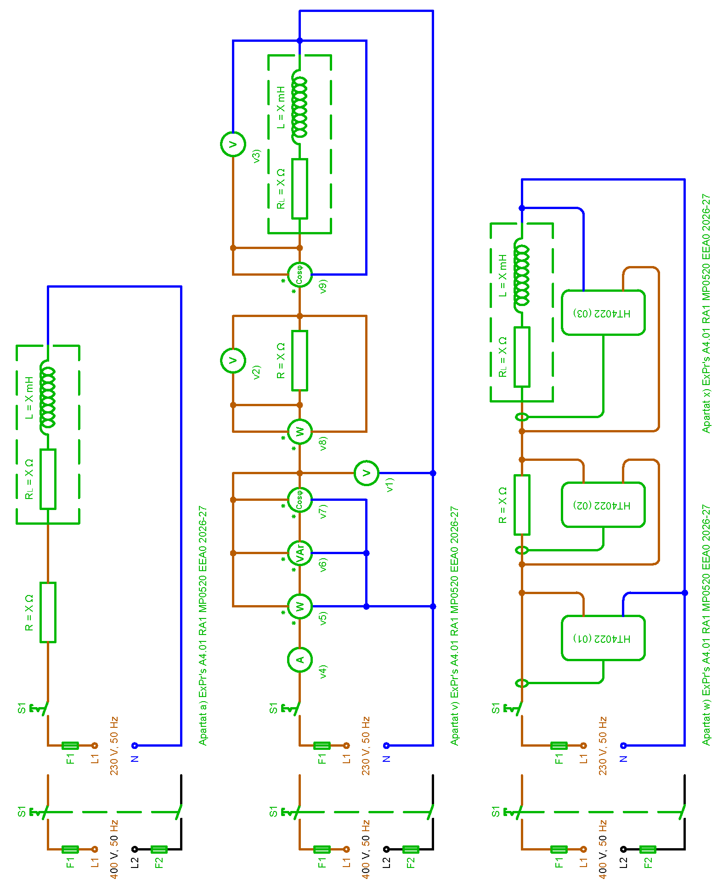

# A4.01 — Anàlisi funcional de circuits monofàsics sèrie RL

CFPS EEA0 Sistemes Electrotècnics i Automatitzats. MP0520 Sistemes i circuits elèctrics. RA1. A4: anàlisi funcional de circuits monofàsics RLC en corrent altern sinusoïdal. A4.01: anàlisi funcional de circuits monofàsics sèrie RL.

Edició 2026-2027: 02/11/2026.

## Exercici proposat 01

Un circuit sèrie format per una resistència R = 10 Ω i una bobina real de resistència R_L = 5 Ω i inductància L = 70 mH s'alimenta amb una tensió alterna sinusoïdal monofàsica de 230 V i 50 Hz. Determina:

a) Esquema elèctric multifilar amb els valors de l'enunciat.
b) Reactància inductiva de la bobina real.
c) Impedància inductiva de la bobina real.
d) Factor de potència en la bobina real.
e) Angle de desfasament en la bobina real (angle de desfasament entre V_ZL i I_ZL).
f) Impedància total.
g) Factor de potència total.
h) Angle de desfasament total (angle de desfasament entre V_T i I_T).
i) Diagrama d'impedàncies, amb tots els seus valors calculats.
j) Intensitat de corrent total.
k) Diagrama V_T – I_T, amb tots els seus valors calculats.
l) Tensió de la resistència.
m) Tensió de la bobina real.
n) Diagrama de tensions, amb tots els seus valors calculats.
o) Potència activa de la resistència.
p) Potència activa de la bobina real.
q) Potència reactiva de la bobina real.
r) Potència activa total.
s) Potència reactiva total.
t) Potència aparent total.
u) Triangle de potències totals, amb tots els seus valors calculats.
v) Esquema elèctric multifilar amb la connexió dels instruments per mesurar: v1) tensió total; v2) tensió de la resistència; v3) tensió de la bobina real; v4) intensitat de corrent total; v5) potència activa total; v6) potència reactiva total; v7) factor de potència total; v8) potència activa de la resistència; v9) factor de potència de la bobina real.
w) Esquema elèctric multifilar amb la connexió de la pinça multímetre digital HT4022 (HT Instruments) per mesurar els paràmetres elèctrics funcionals calculats i els de l'enunciat.
x) Valors que indicarà la pinça multímetre digital de l'apartat anterior segons les posicions (0x) de connexió.

## Exercici proposat 02

Un circuit sèrie format per una resistència R = 15 Ω i una bobina real de resistència R_L = 5 Ω i inductància L = 100 mH s'alimenta amb una tensió alterna sinusoïdal monofàsica de 230 V i 50 Hz. Determina els mateixos apartats que a l'exercici 01.

## Exercici proposat 03

Un circuit sèrie format per una resistència R = 5 Ω i una bobina real de resistència R_L = 5 Ω i inductància L = 150 mH s'alimenta amb una tensió alterna sinusoïdal monofàsica de 230 V i 50 Hz. Determina els mateixos apartats que a l'exercici 01.

## Annex 01. Solucions a), v), w) i x) dels exercicis proposats 01, 02 i 03

