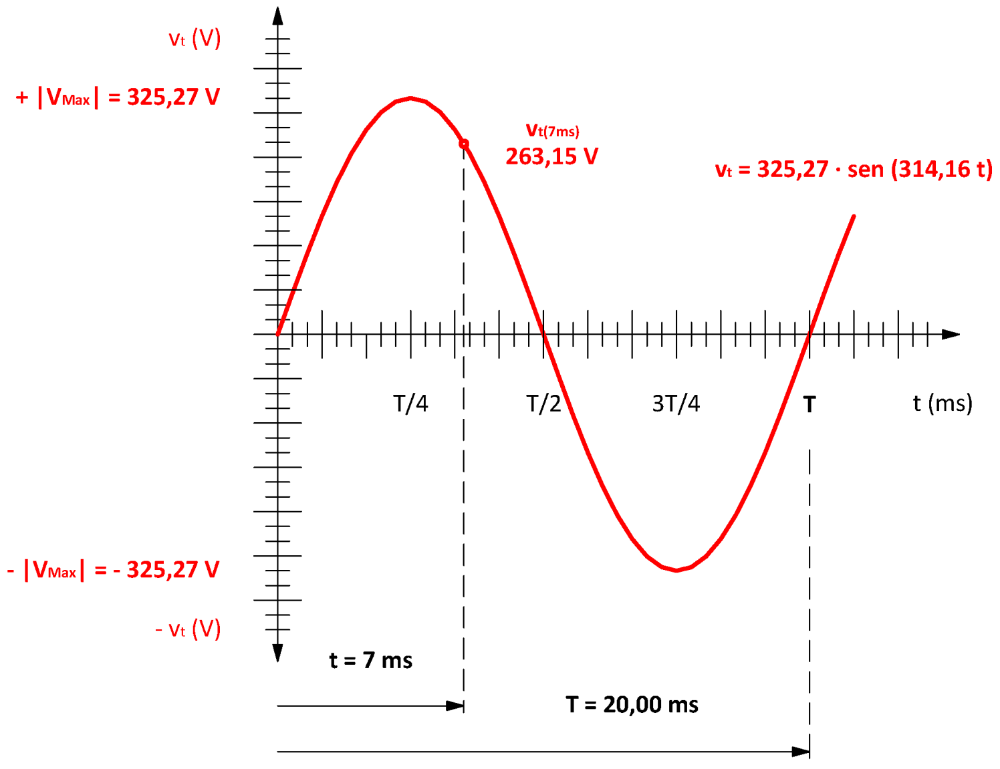
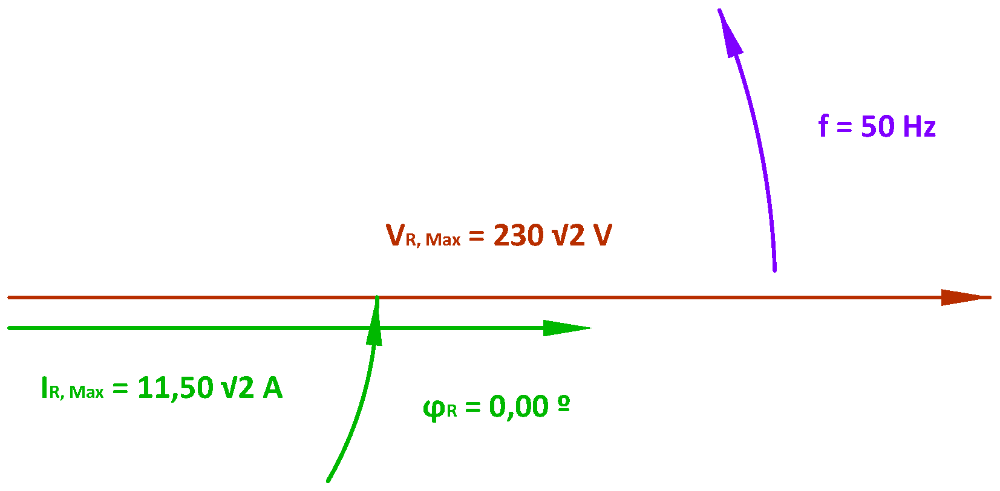
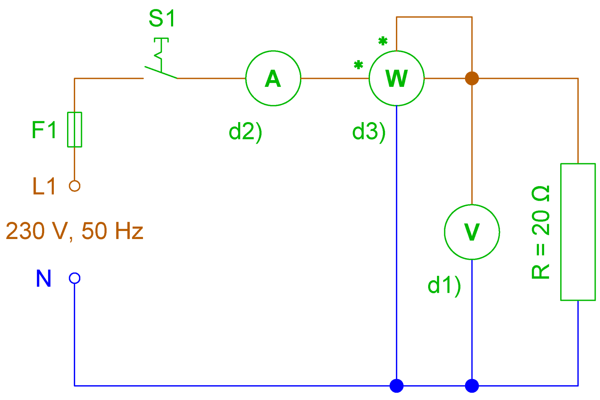
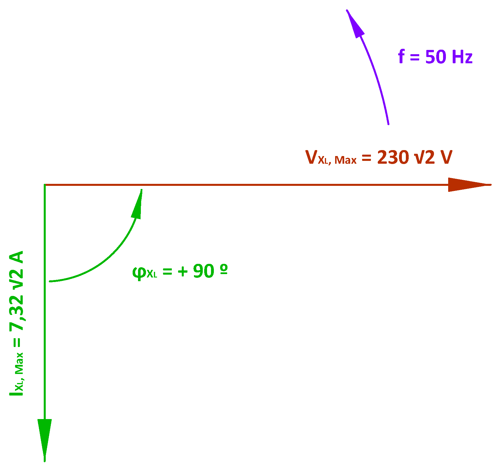
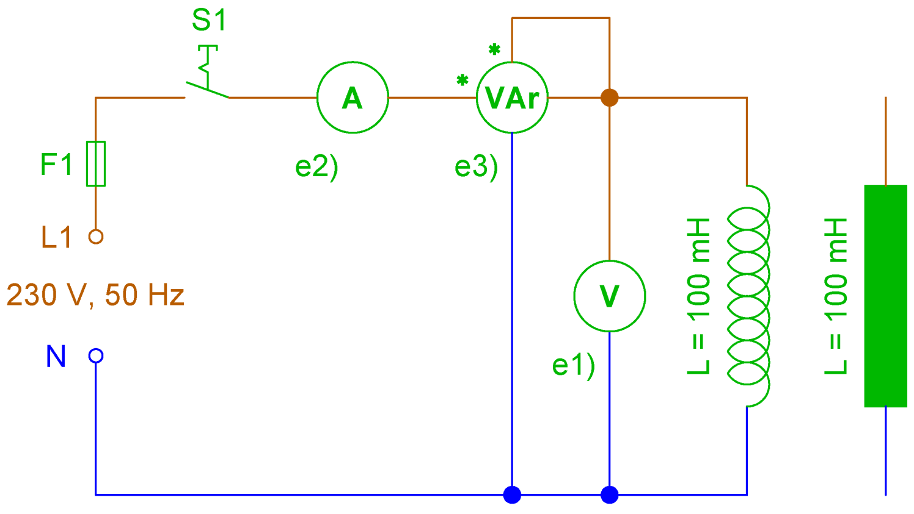
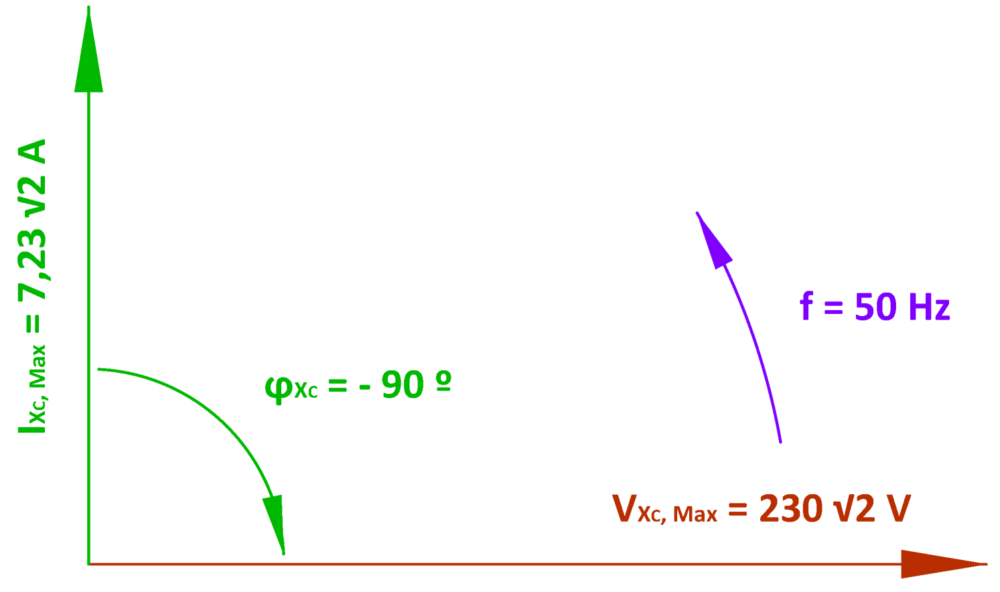
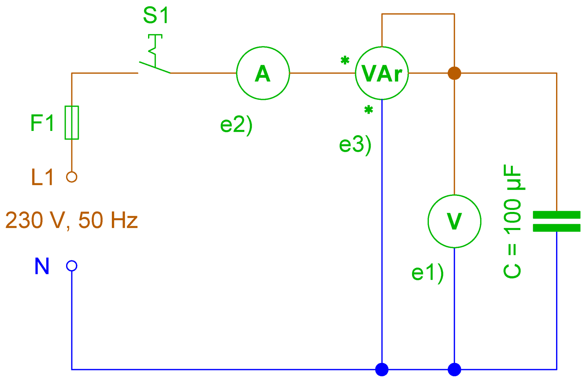
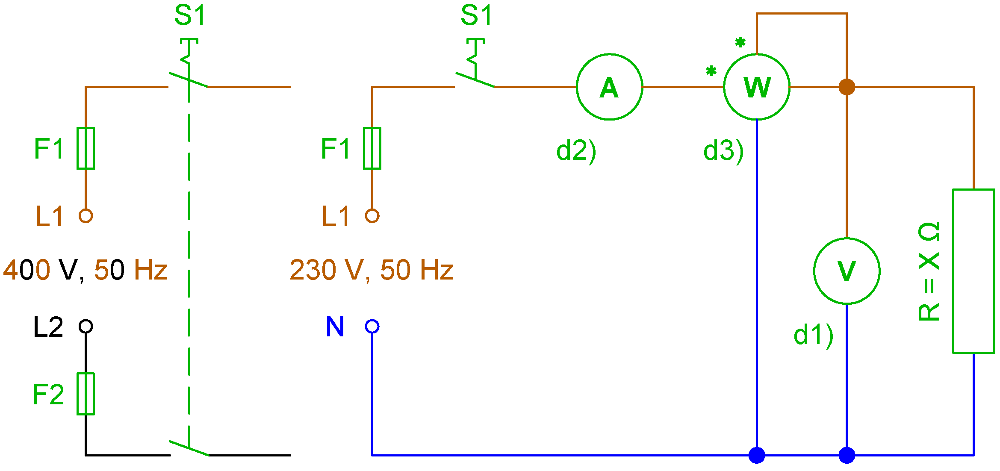
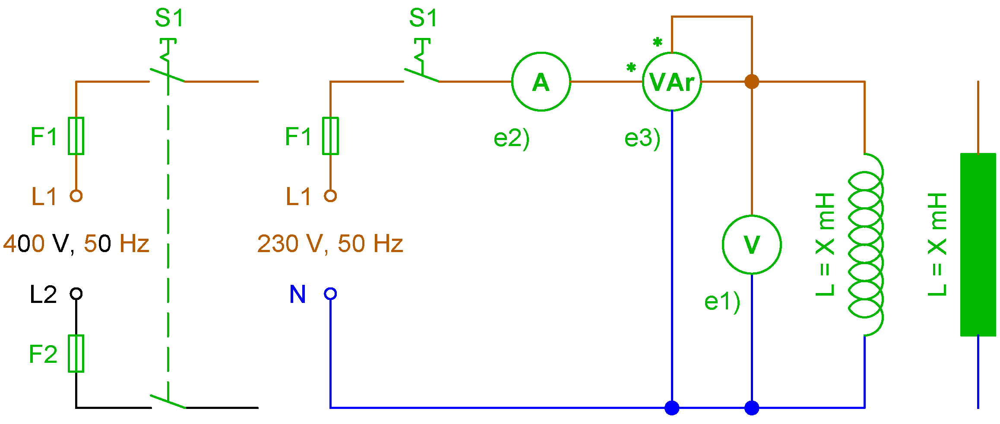
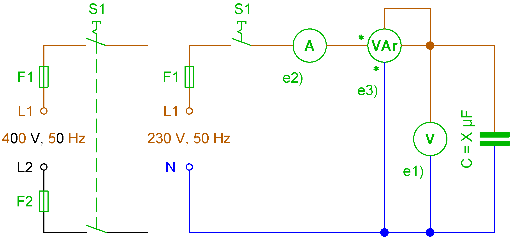

# Resolució A2 — Exercicis proposats A.01, B.01, C.01 i D.01

CFPS EEA0 Sistemes Electrotècnics i Automatitzats. MP0520 Sistemes i circuits elèctrics. RA1. Edició 2026-2027: 01/10/2026.

## A. Paràmetres característics d'una tensió alterna sinusoïdal

### Resolució de l'exercici proposat A.01

Enunciat: tensió alterna sinusoïdal monofàsica de 230 V i 50 Hz.

**a) Període**

$$
T = \frac{1}{f} = \frac{1}{50} = 0{,}0200\ \text{s} = 20{,}00\ \text{ms}
$$

**b) Valor màxim, absolut**

$$
V_{max} = V \cdot \sqrt{2} = 230 \cdot \sqrt{2} = 325{,}27\ \text{V}
$$

**c) Pulsació**

$$
\omega = 2\pi f = 2\pi \cdot 50 = 314{,}16\ \text{rad/s}
$$

**d) Valor a l'instant 7 ms**

$$
v(t) = V_{max} \cdot \operatorname{sen}\left(\omega t\right)
$$

$$
v(t) = 325{,}27 \cdot \operatorname{sen}\left(314{,}16 \cdot t\right)
$$

$$
t = 7\ \text{ms} = 0{,}007\ \text{s}
$$

$$
v(7\ \text{ms}) = 325{,}27 \cdot \operatorname{sen}\left(314{,}16 \cdot 0{,}007\right) = 263{,}15\ \text{V}
$$

**e) Representació gràfica**

## B. Anàlisi funcional d'una resistència en corrent altern sinusoïdal

### Resolució de l'exercici proposat B.01

Enunciat: R = 20 Ω, tensió monofàsica de 230 V i 50 Hz.

**a) Intensitat de corrent**

$$
I_R = \frac{V_R}{R} = \frac{230}{20} = 11{,}5\ \text{A}
$$

**b) Diagrama vectorial V_R – I_R**

En una resistència, tensió i corrent estan en fase: φ_R = 0°.

**c) Potència activa**

$$
P_R = V_R \cdot I_R \cdot \cos\varphi
$$

$$
\cos\varphi = \cos 0^\circ = 1{,}00\ \text{(resistiu)}
$$

$$
P_R = 230 \cdot 11{,}50 \cdot 1{,}00 = 2.645{,}00\ \text{W}
$$

**d) Esquema de mesura**

## C. Anàlisi funcional d'una inductància en corrent altern sinusoïdal

### Resolució de l'exercici proposat C.01

Enunciat: L = 100 mH, tensió monofàsica de 230 V i 50 Hz.

**a) Reactància inductiva**

$$
X_L = 2\pi f L
$$

$$
L = 100\ \text{mH} = 0{,}10\ \text{H}
$$

$$
X_L = 2\pi \cdot 50 \cdot 0{,}10 = 31{,}42\ \Omega
$$

**b) Intensitat de corrent**

$$
I_{X_L} = \frac{V_{X_L}}{X_L} = \frac{230}{31{,}42} = 7{,}32\ \text{A}
$$

**c) Diagrama vectorial V_XL – I_XL**

En una inductància, la corrent es retarda 90° respecte de la tensió: φ_XL = +90°.

**d) Potència reactiva**

$$
Q_{X_L} = V_{X_L} \cdot I_{X_L} \cdot \operatorname{sen}\varphi
$$

$$
\operatorname{sen}\varphi = \operatorname{sen} 90^\circ = 1{,}00\ \text{(inductiu)}
$$

$$
Q_{X_L} = 230 \cdot 7{,}32 \cdot 1{,}00 = 1.683{,}60\ \text{VAr}
$$

**e) Esquema de mesura**

## D. Anàlisi funcional d'una capacitància en corrent altern sinusoïdal

### Resolució de l'exercici proposat D.01

Enunciat: C = 100 µF, tensió monofàsica de 230 V i 50 Hz.

**a) Reactància capacitiva**

$$
X_C = \frac{1}{2\pi f C}
$$

$$
C = 100\ \mu\text{F} = 100 \cdot 10^{-6}\ \text{F}
$$

$$
X_C = \frac{1}{2\pi \cdot 50 \cdot 100 \cdot 10^{-6}} = 31{,}83\ \Omega
$$

**b) Intensitat de corrent**

$$
I_{X_C} = \frac{V_{X_C}}{X_C} = \frac{230}{31{,}83} = 7{,}23\ \text{A}
$$

**c) Diagrama vectorial V_XC – I_XC**

En una capacitància, la corrent s'avança 90° respecte de la tensió: φ_XC = −90°.

**d) Potència reactiva**

$$
Q_{X_C} = V_{X_C} \cdot I_{X_C} \cdot \operatorname{sen}\varphi
$$

$$
\operatorname{sen}\varphi = \operatorname{sen}\left(-90^\circ\right) = -1{,}00\ \text{(capacitiu)}
$$

$$
Q_{X_C} = 230 \cdot 7{,}23 \cdot \left(-1{,}00\right) = -1.662{,}90\ \text{VAr}
$$

**e) Esquema de mesura**

## Annex 01. Solucions d) i e) dels exercicis proposats B.0x, C.0x i D.0x

