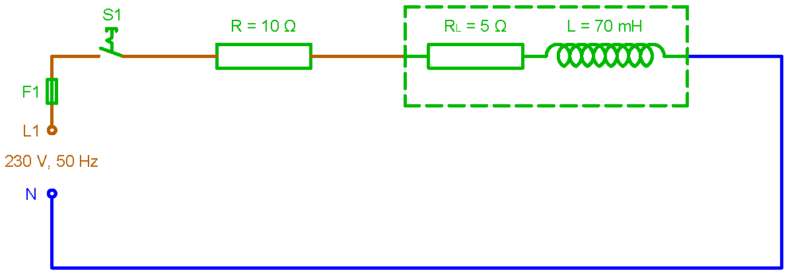
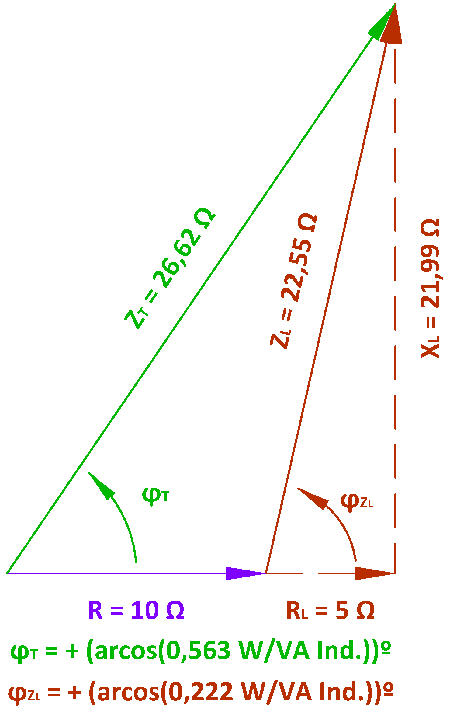
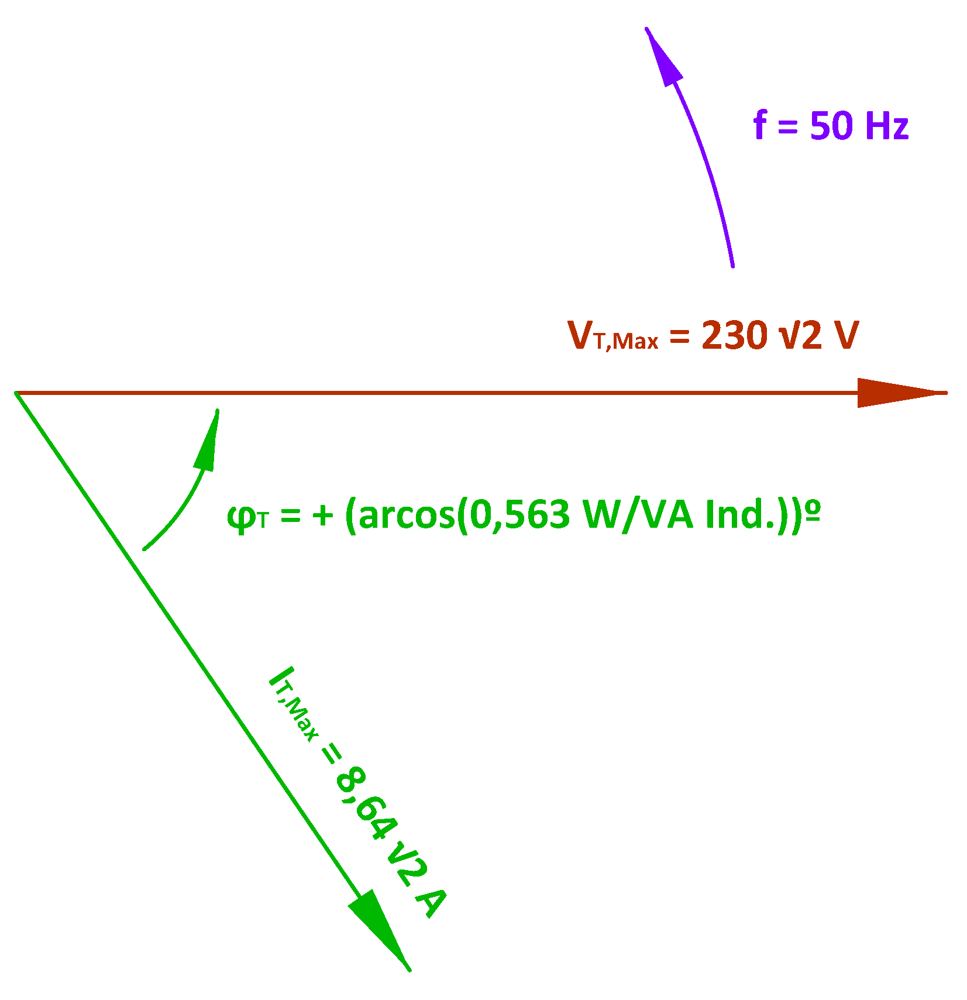
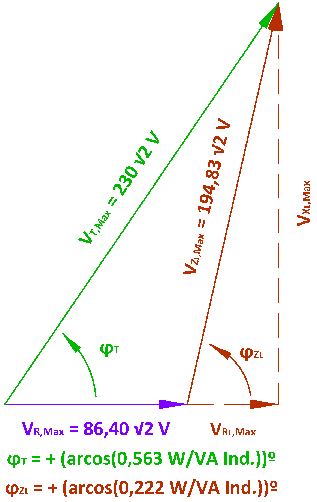
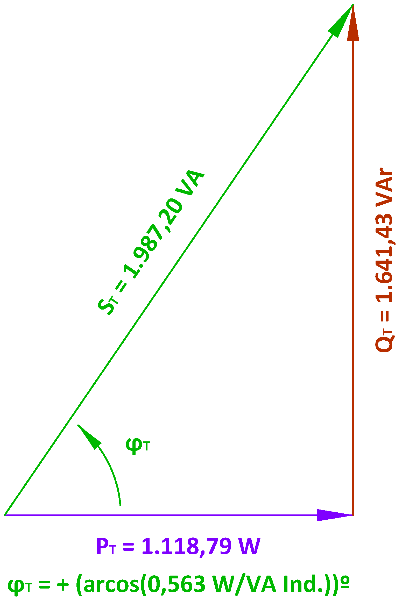
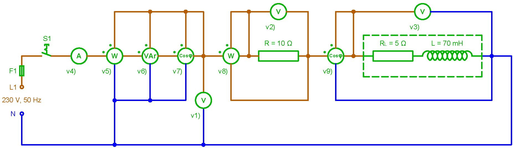
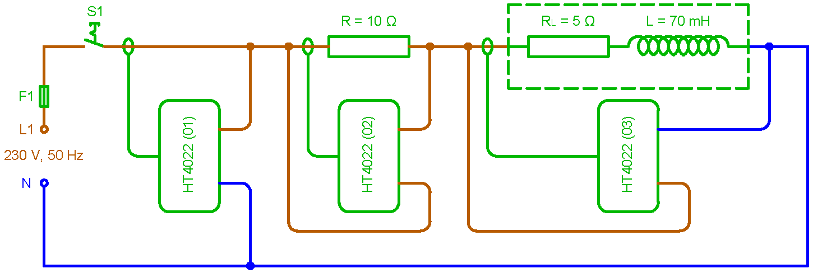

# Resolució A4.01 — Exercici proposat 01

CFPS EEA0 Sistemes Electrotècnics i Automatitzats. MP0520 Sistemes i circuits elèctrics. RA1. A4.01: anàlisi funcional de circuits monofàsics sèrie RL en corrent altern sinusoïdal. Edició 2026-2027: 02/11/2026.

## Enunciat

Un circuit sèrie format per una resistència R = 10 Ω i una bobina real de resistència R_L = 5 Ω i inductància L = 70 mH s'alimenta amb una tensió alterna sinusoïdal monofàsica de 230 V i 50 Hz.

## Resolució

**a) Esquema elèctric multifilar**

**b) Reactància inductiva de la bobina real**

$$
X_L = 2\pi f L
$$

$$
L = 70\ \text{mH} = 0{,}07\ \text{H}
$$

$$
X_L = 2\pi \cdot 50 \cdot 0{,}07 = 21{,}99\ \Omega
$$

**c) Impedància inductiva de la bobina real**

$$
Z_L = \sqrt{R_L^2 + X_L^2}
$$

$$
Z_L = \sqrt{5^2 + 21{,}99^2} = 22{,}55\ \Omega
$$

**d) Factor de potència en la bobina real**

$$
\cos\varphi_{Z_L} = \frac{R_L}{Z_L} = \frac{5}{22{,}55} = 0{,}222\ \text{(inductiu)}
$$

**e) Angle de desfasament en la bobina real**

$$
\varphi_{Z_L} = +\arccos\left(\frac{R_L}{Z_L}\right) = +\arccos\left(\frac{5}{22{,}55}\right) = +77{,}189^\circ
$$

**f) Impedància total**

$$
Z_T = \sqrt{\left(R + R_L\right)^2 + X_L^2}
$$

$$
Z_T = \sqrt{\left(10 + 5\right)^2 + 21{,}99^2} = 26{,}62\ \Omega
$$

**g) Factor de potència total**

$$
\cos\varphi_T = \frac{R + R_L}{Z_T} = \frac{10 + 5}{26{,}62} = 0{,}563\ \text{(inductiu)}
$$

**h) Angle de desfasament total**

$$
\varphi_T = +\arccos\left(\frac{R + R_L}{Z_T}\right) = +\arccos\left(\frac{10 + 5}{26{,}62}\right) = +55{,}703^\circ
$$

**i) Diagrama d'impedàncies**

**j) Intensitat de corrent total**

$$
I_T = \frac{V_T}{Z_T} = \frac{230}{26{,}62} = 8{,}64\ \text{A}
$$

**k) Diagrama V_T – I_T**

**l) Tensió de la resistència**

$$
V_R = R \cdot I = 10 \cdot 8{,}64 = 86{,}40\ \text{V}
$$

**m) Tensió de la bobina real**

$$
V_{Z_L} = Z_L \cdot I = 22{,}55 \cdot 8{,}64 = 194{,}83\ \text{V}
$$

**n) Diagrama de tensions**

**o) Potència activa de la resistència**

$$
P_R = V_R \cdot I_R \cdot \cos\varphi_R
$$

$$
\cos\varphi_R = \cos 0^\circ = 1{,}00\ \text{(resistiu)}
$$

$$
P_R = 86{,}40 \cdot 8{,}64 \cdot 1{,}00 = 746{,}50\ \text{W}
$$

**p) Potència activa de la bobina real**

$$
P_{Z_L} = V_{Z_L} \cdot I_{Z_L} \cdot \cos\varphi_{Z_L}
$$

$$
P_{Z_L} = 194{,}83 \cdot 8{,}64 \cdot 0{,}222 = 373{,}70\ \text{W}
$$

**q) Potència reactiva de la bobina real**

$$
Q_{Z_L} = V_{Z_L} \cdot I_{Z_L} \cdot \operatorname{sen}\varphi_{Z_L}
$$

$$
\operatorname{sen}\varphi_{Z_L} = \operatorname{sen} 77{,}189^\circ = 0{,}975\ \text{(inductiu)}
$$

$$
Q_{Z_L} = 194{,}83 \cdot 8{,}64 \cdot 0{,}975 = 1.641{,}25\ \text{VAr}
$$

**r) Potència activa total**

$$
P_T = V_T \cdot I_T \cdot \cos\varphi_T = P_R + P_{Z_L}
$$

$$
P_T = 230 \cdot 8{,}64 \cdot 0{,}563 = 1.118{,}79\ \text{W}
$$

**s) Potència reactiva total**

$$
Q_T = V_T \cdot I_T \cdot \operatorname{sen}\varphi_T = Q_{Z_L}
$$

$$
\operatorname{sen}\varphi_T = \operatorname{sen} 55{,}703^\circ = 0{,}826\ \text{(inductiu)}
$$

$$
Q_T = 230 \cdot 8{,}64 \cdot 0{,}826 = 1.641{,}43\ \text{VAr}
$$

**t) Potència aparent total**

$$
S_T = V_T \cdot I_T = \sqrt{P_T^2 + Q_T^2}
$$

$$
S_T = 230 \cdot 8{,}64 = 1.987{,}20\ \text{VA}
$$

**u) Triangle de potències totals**

**v) Esquema de mesura amb instruments**

**w) Esquema de mesura amb la pinça HT4022**

**x) Valors indicats per la pinça HT4022**

| Magnitud | HT4022 (01) Sèrie RL | HT4022 (02) Resistència R | HT4022 (03) Bobina real Z_L |
|---|---|---|---|
| V ; f | 230 V ; 50 Hz | 86,40 V ; 50 Hz | 194,83 V ; 50 Hz |
| I | 8,64 A | 8,64 A | 8,64 A |
| P | 1.118,79 W | 746,50 W | 373,70 W |
| Q | 1.641,43 VAr | 0,00 VAr | 1.641,25 VAr |
| S | 1.987,20 VA | 86,40 · 8,64 VA | 194,83 · 8,64 VA |
| f.d.p. | 0,563 inductiu | 1,00 resistiu | 0,222 inductiu |
