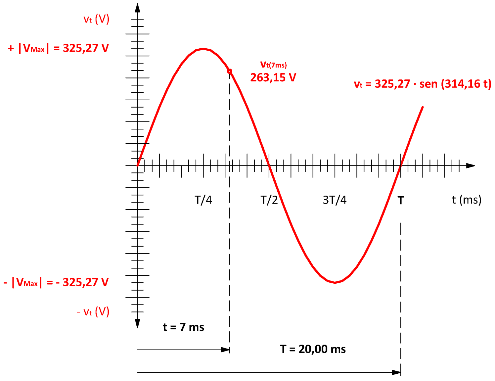
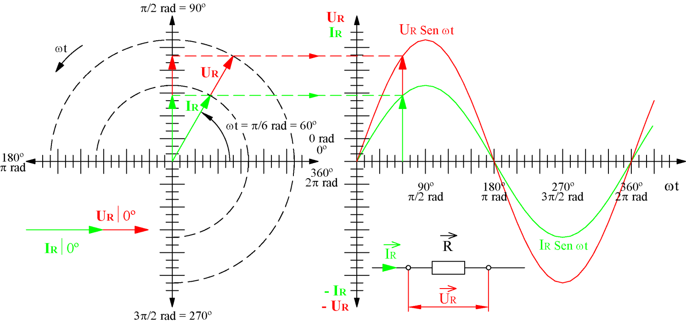
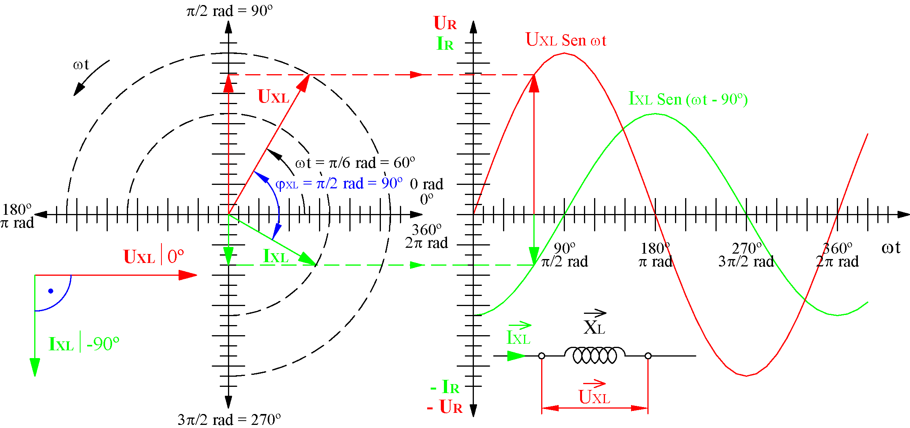
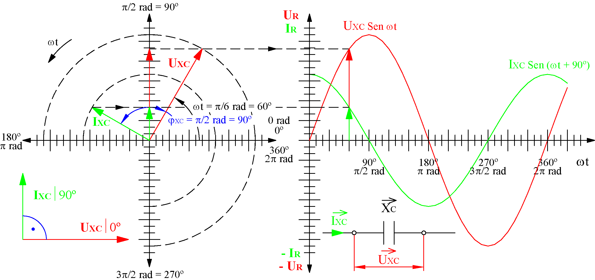
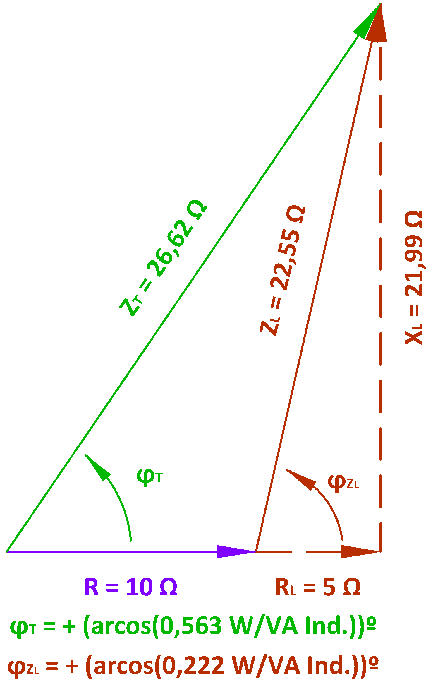
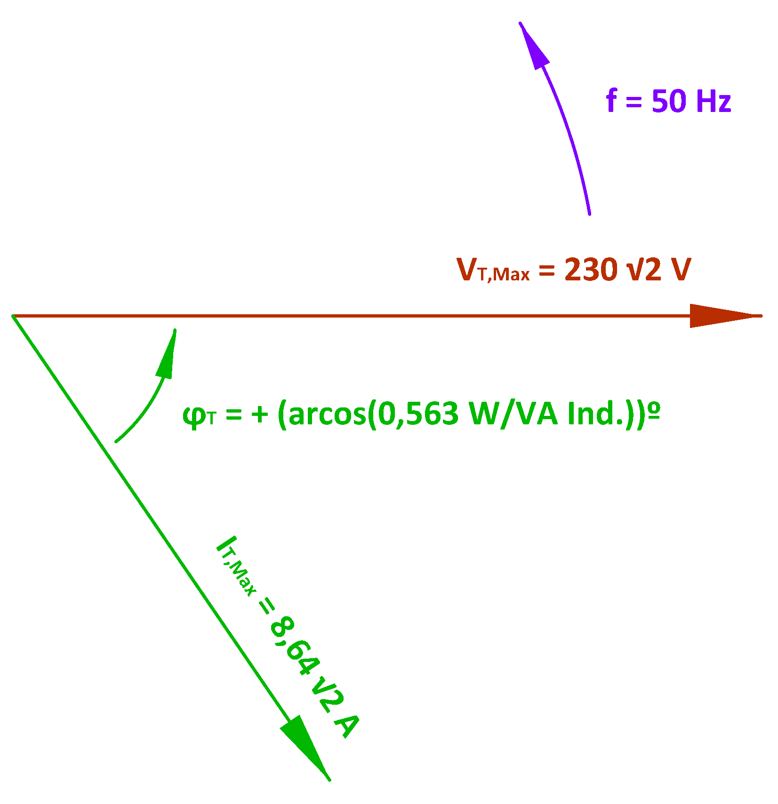
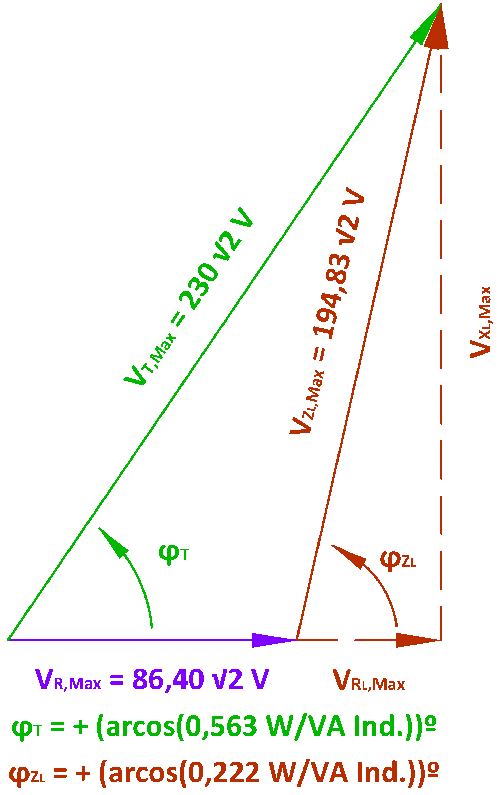
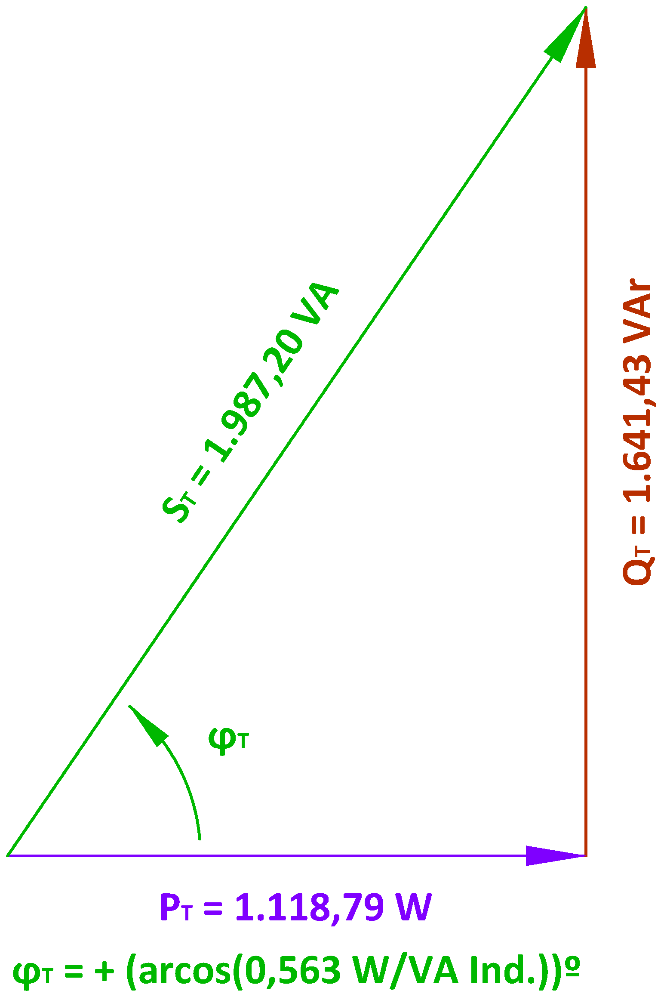
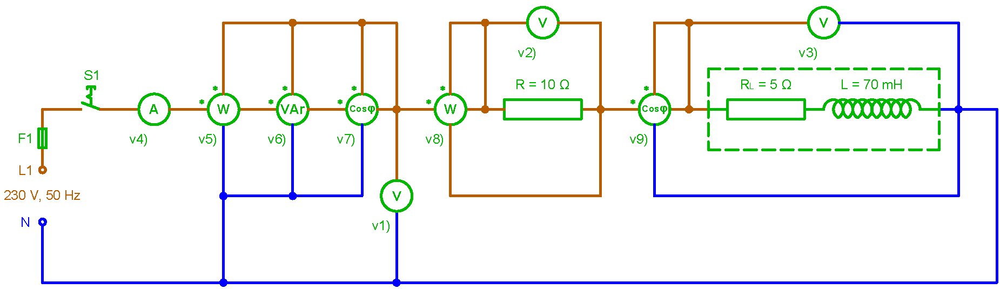
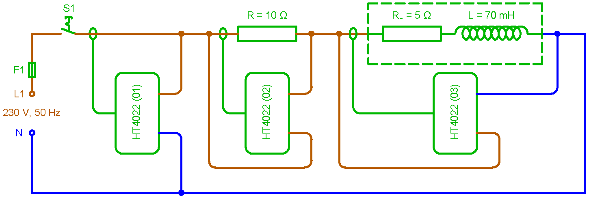

# Corriente alterna sinusoidal y circuitos RL en serie

Fundamentos de la tensión alterna sinusoidal y del comportamiento de resistencias, inductancias y capacitancias, con el método completo de resolución de un circuito monofásico serie RL formado por una resistencia y una bobina real.

## Puntos clave

- Una tensión sinusoidal se describe con $v(t) = V_{max} \cdot \operatorname{sen}(\omega t)$. La relación entre valor eficaz y máximo es $V_{max} = V \cdot \sqrt{2}$; el período es $T = 1/f$ y la pulsación $\omega = 2\pi f$.
- En una **resistencia** la tensión y la corriente están en fase ($\varphi = 0^\circ$), la impedancia es $Z = R$ y solo hay potencia activa: $P = V \cdot I$.
- En una **inductancia** la corriente se retarda $90^\circ$ respecto de la tensión ($\varphi = +90^\circ$), la reactancia es $X_L = 2\pi f L$ y solo hay potencia reactiva inductiva: $Q = V \cdot I$.
- En una **capacitancia** la corriente se adelanta $90^\circ$ respecto de la tensión ($\varphi = -90^\circ$), la reactancia es $X_C = 1/(2\pi f C)$ y solo hay potencia reactiva capacitiva: $Q = V \cdot I$, con signo negativo.
- En un **circuito serie RL con bobina real**, la bobina tiene su propia resistencia $R_L$: $Z_L = \sqrt{R_L^2 + X_L^2}$ y $\cos\varphi_{Z_L} = R_L/Z_L$. La impedancia total es $Z_T = \sqrt{(R + R_L)^2 + X_L^2}$ y $\cos\varphi_T = (R + R_L)/Z_T$.
- La corriente total es $I_T = V_T/Z_T$; las tensiones parciales son $V_R = R \cdot I_T$ y $V_{Z_L} = Z_L \cdot I_T$.
- Las potencias se conservan: $P_T = P_R + P_{Z_L}$, $Q_T = Q_{Z_L}$ y $S_T = V_T \cdot I_T = \sqrt{P_T^2 + Q_T^2}$.
- La medida se hace con amperímetro en serie, voltímetro en paralelo y vatímetro, varímetro o cosímetro según la magnitud; una pinza multímetro como la HT4022 permite comprobar tensión, corriente, potencia y factor de potencia en cada tramo.

## Detalles

### Parámetros de una tensión alterna sinusoidal

Una tensión alterna sinusoidal monofásica se representa como:

$$
v(t) = V_{max} \cdot \operatorname{sen}\left(\omega t\right)
$$

donde $V_{max}$ es el valor máximo o de cresta, $\omega$ la pulsación en rad/s y $t$ el tiempo en segundos. El valor eficaz $V$ es el que indica un voltímetro y el que se usa en los cálculos de potencia:

$$
V_{max} = V \cdot \sqrt{2}
$$

$$
\omega = 2\pi f
$$

$$
T = \frac{1}{f}
$$

**Ejemplo resuelto (A.01)**: para 230 V y 50 Hz,

$$
T = \frac{1}{50} = 0{,}0200\ \text{s} = 20{,}00\ \text{ms}
$$

$$
V_{max} = 230 \cdot \sqrt{2} = 325{,}27\ \text{V}
$$

$$
\omega = 2\pi \cdot 50 = 314{,}16\ \text{rad/s}
$$

$$
v(7\ \text{ms}) = 325{,}27 \cdot \operatorname{sen}\left(314{,}16 \cdot 0{,}007\right) = 263{,}15\ \text{V}
$$

### Comportamiento de R, L y C en corriente alterna

| Carga | Impedancia o reactancia | Desfase tensión–corriente | Potencia |
|---|---|---|---|
| Resistencia $R$ | $Z = R$ | $0^\circ$ (en fase) | Activa: $P = V \cdot I$ |
| Inductancia $L$ | $X_L = 2\pi f L$ | Corriente retrasada $90^\circ$ ($\varphi = +90^\circ$) | Reactiva inductiva: $Q = V \cdot I$ |
| Capacitancia $C$ | $X_C = \dfrac{1}{2\pi f C}$ | Corriente adelantada $90^\circ$ ($\varphi = -90^\circ$) | Reactiva capacitiva: $Q = -V \cdot I$ |

En la resistencia, tensión y corriente alcanzan el máximo a la vez:

En la inductancia, la corriente llega $90^\circ$ después que la tensión:

En la capacitancia, la corriente llega $90^\circ$ antes que la tensión:

**Ejemplos resueltos con 230 V y 50 Hz:**

$$
X_L = 2\pi \cdot 50 \cdot 0{,}10 = 31{,}42\ \Omega \quad\Rightarrow\quad I = \frac{230}{31{,}42} = 7{,}32\ \text{A}
$$

$$
Q_{X_L} = 230 \cdot 7{,}32 \cdot \operatorname{sen} 90^\circ = 1.683{,}60\ \text{VAr (inductivo)}
$$

$$
X_C = \frac{1}{2\pi \cdot 50 \cdot 100 \cdot 10^{-6}} = 31{,}83\ \Omega \quad\Rightarrow\quad I = \frac{230}{31{,}83} = 7{,}23\ \text{A}
$$

$$
Q_{X_C} = 230 \cdot 7{,}23 \cdot \operatorname{sen}\left(-90^\circ\right) = -1.662{,}90\ \text{VAr (capacitivo)}
$$

### Circuito serie RL con bobina real

Una bobina real no es una inductancia pura: su devanado tiene una resistencia $R_L$. Por eso el circuito serie se modela con la resistencia exterior $R$ en serie con la bobina real, que a su vez se descompone en $R_L$ y $L$.

**Bobina real:**

$$
X_L = 2\pi f L
$$

$$
Z_L = \sqrt{R_L^2 + X_L^2}
$$

$$
\cos\varphi_{Z_L} = \frac{R_L}{Z_L}
$$

$$
\varphi_{Z_L} = +\arccos\left(\frac{R_L}{Z_L}\right)
$$

**Circuito total:**

$$
Z_T = \sqrt{\left(R + R_L\right)^2 + X_L^2}
$$

$$
\cos\varphi_T = \frac{R + R_L}{Z_T}
$$

$$
\varphi_T = +\arccos\left(\frac{R + R_L}{Z_T}\right)
$$

$$
I_T = \frac{V_T}{Z_T}
$$

**Tensiones parciales:**

$$
V_R = R \cdot I_T
$$

$$
V_{Z_L} = Z_L \cdot I_T
$$

**Potencias:**

$$
P_R = V_R \cdot I_T \cdot \cos 0^\circ = V_R \cdot I_T
$$

$$
P_{Z_L} = V_{Z_L} \cdot I_T \cdot \cos\varphi_{Z_L}
$$

$$
Q_{Z_L} = V_{Z_L} \cdot I_T \cdot \operatorname{sen}\varphi_{Z_L}
$$

$$
P_T = V_T \cdot I_T \cdot \cos\varphi_T = P_R + P_{Z_L}
$$

$$
Q_T = V_T \cdot I_T \cdot \operatorname{sen}\varphi_T = Q_{Z_L}
$$

$$
S_T = V_T \cdot I_T = \sqrt{P_T^2 + Q_T^2}
$$

#### Ejemplo resuelto (A4.01, ejercicio 01)

Datos: $R = 10\ \Omega$, $R_L = 5\ \Omega$, $L = 70\ \text{mH}$, $V_T = 230\ \text{V}$, $f = 50\ \text{Hz}$.

$$
X_L = 2\pi \cdot 50 \cdot 0{,}07 = 21{,}99\ \Omega
$$

$$
Z_L = \sqrt{5^2 + 21{,}99^2} = 22{,}55\ \Omega
$$

$$
\cos\varphi_{Z_L} = \frac{5}{22{,}55} = 0{,}222 \quad\Rightarrow\quad \varphi_{Z_L} = +77{,}189^\circ
$$

$$
Z_T = \sqrt{\left(10 + 5\right)^2 + 21{,}99^2} = 26{,}62\ \Omega
$$

$$
\cos\varphi_T = \frac{15}{26{,}62} = 0{,}563 \quad\Rightarrow\quad \varphi_T = +55{,}703^\circ
$$

$$
I_T = \frac{230}{26{,}62} = 8{,}64\ \text{A}
$$

$$
V_R = 10 \cdot 8{,}64 = 86{,}40\ \text{V}
$$

$$
V_{Z_L} = 22{,}55 \cdot 8{,}64 = 194{,}83\ \text{V}
$$

$$
P_R = 86{,}40 \cdot 8{,}64 = 746{,}50\ \text{W}
$$

$$
P_{Z_L} = 194{,}83 \cdot 8{,}64 \cdot 0{,}222 = 373{,}70\ \text{W}
$$

$$
Q_{Z_L} = 194{,}83 \cdot 8{,}64 \cdot 0{,}975 = 1.641{,}25\ \text{VAr}
$$

$$
P_T = 230 \cdot 8{,}64 \cdot 0{,}563 = 1.118{,}79\ \text{W}
$$

$$
Q_T = 230 \cdot 8{,}64 \cdot 0{,}826 = 1.641{,}43\ \text{VAr}
$$

$$
S_T = 230 \cdot 8{,}64 = 1.987{,}20\ \text{VA}
$$

El diagrama de impedancias muestra cómo se suman $R$, $R_L$ y $X_L$:

La tensión total adelanta a la corriente el ángulo $\varphi_T$:

Las tensiones parciales no se suman aritméticamente, sino vectorialmente:

El triángulo de potencias cierra con $P_T$, $Q_T$ y $S_T$:

### Medida de las magnitudes

La medida se organiza según la magnitud:

- **Tensión**: voltímetro en paralelo con el tramo (total, resistencia o bobina).
- **Corriente**: amperímetro en serie con el circuito.
- **Potencia activa**: vatímetro, con su circuito de tensión en paralelo y su circuito de corriente en serie.
- **Potencia reactiva**: varímetro.
- **Factor de potencia**: cosímetro.

Con una pinza multímetro digital como la **HT4022** se obtienen varias magnitudes sin abrir el circuito. En el ejemplo, las tres posiciones dan:

| Magnitud | HT4022 (01) Serie RL | HT4022 (02) Resistencia R | HT4022 (03) Bobina real Z_L |
|---|---|---|---|
| V ; f | 230 V ; 50 Hz | 86,40 V ; 50 Hz | 194,83 V ; 50 Hz |
| I | 8,64 A | 8,64 A | 8,64 A |
| P | 1.118,79 W | 746,50 W | 373,70 W |
| Q | 1.641,43 VAr | 0,00 VAr | 1.641,25 VAr |
| S | 1.987,20 VA | 86,40 · 8,64 VA | 194,83 · 8,64 VA |
| f.d.p. | 0,563 inductivo | 1,00 resistivo | 0,222 inductivo |

### Ejercicios propuestos

Los tres ejercicios del cuaderno A4.01 comparten el mismo procedimiento con estos datos:

| Ejercicio | $R$ | $R_L$ | $L$ | Tensión y frecuencia |
|---|---|---|---|---|
| 01 | 10 Ω | 5 Ω | 70 mH | 230 V, 50 Hz |
| 02 | 15 Ω | 5 Ω | 100 mH | 230 V, 50 Hz |
| 03 | 5 Ω | 5 Ω | 150 mH | 230 V, 50 Hz |

El ejercicio 01 está resuelto paso a paso en la fuente; los ejercicios 02 y 03 se resuelven con las mismas fórmulas cambiando los datos.

> Nota de la fuente: el cuaderno A2 y el A4.01 son material docente del Institut Serrallarga (CFPS EEA0, MP0520, curso 2026-27), no una norma. Las fórmulas y los criterios son los habituales de la teoría de circuitos de corriente alterna.

## Relacionado

- [[instalaciones-interiores-viviendas-bt]] — circuitos de vivienda y potencias previstas
- [[itc-bt-25-instalaciones-interiores-en-viviendas-numero-de-circuitos-y-caracteristicas]] — secciones, protecciones y circuitos C1–C13
- [[analizador-de-redes-calidad-de-energia]] — medida de potencias, armónicos y factor de potencia en instalaciones reales
- [[itc-bt-44-instalacion-de-receptores-receptores-para-alumbrado]] — compensación del factor de potencia
- [[guia-rebt-anexo-3-calculo-de-corrientes-de-cortocircuito]] — cálculo de corrientes de defecto
